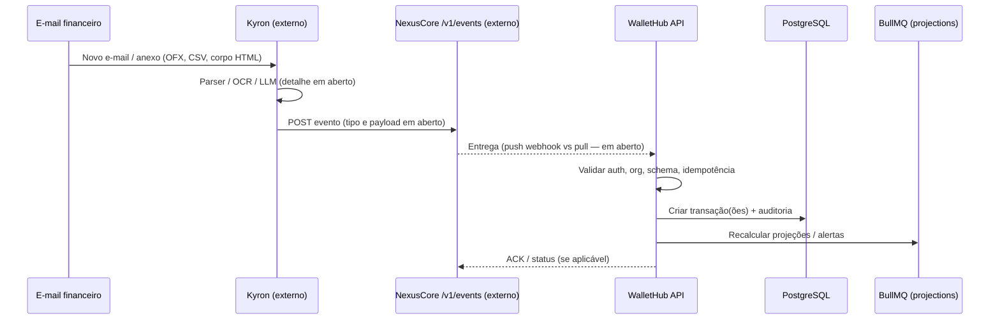

# WalletHub Connector — Análise Exploratória

> **Status:** esboço exploratório — **não** é plano de implementação nem decisão arquitetural.  
> **Pendente:** ADR formal, refinamento de requisitos e alinhamento com NexusCore/Kyron.  
> **Escopo deste documento:** levantar fluxo, componentes, questões em aberto e opções de design sem escolher caminho definitivo.

---

## 1. Contexto e motivação

O ecossistema prevê um fluxo em que o **Kyron** (agente externo a este repositório) lê **e-mails financeiros**, extrai transações e publica um **evento** no **NexusCore**, que o **WalletHub** consome via uma **API de ingestão** (ainda a construir).

Registos no NexusCore indicam que o conector está **pendente de ADR e implementação**; o schema de transação no evento **ainda não está desenhado**. Este repositório **não contém** código do Kyron nem do NexusCore — apenas referências pontuais em ADRs e runbooks (ex.: `store_knowledge`, `record_event`).

### Baseline verificável no WalletHub (hoje)

| Área | Estado actual |
|------|----------------|
| CRUD de transações | `POST /api/transactions`, entidade `transactions` com `organization_id`, `account_id`, `category_id`, `direction`, `amount`, `external_id`, `source` |
| `source` permitido | `web`, `whatsapp`, `telegram` — **não** existe valor para conector/Kyron |
| Importação de extrato | `StatementImportService` + `/imports/statement/*` (OFX/CSV, web e WhatsApp) |
| Deduplicação de import | `external_id` (FITID ou sintético CSV), `statement_import_batches.file_hash`, índices únicos parciais — ver [ADR OFX/CSV](../decisions/adr-ofx-import-audit.md) |
| Auth serviço-a-serviço | `AdminTokenGuard` + `WALLETHUB_ADMIN_TOKEN` (ex.: `backup.controller.ts`, `qa-admin.controller.ts`) |
| Multi-tenant | `ActiveOrganizationGuard` + cabeçalho `X-Organization-Id` |
| Planos / gating | `webStatementImport` e `whatsappStatementImport` exigem plano `pro`+ |

---

## 2. Fluxo ponta-a-ponta (pretendido)

Diagrama lógico — componentes **fora** deste repo assinalados como *externos*; linhas tracejadas = contratos **não verificados** no código WalletHub.



### Componentes envolvidos

| Componente | Responsabilidade provável | Repo / verificação |
|------------|---------------------------|-------------------|
| **Caixa de e-mail** | Fonte de extratos, alertas de banco, faturas | Externo; credenciais e escopo LGPD em aberto |
| **Kyron** | Monitorar inbox, classificar, extrair lançamentos, montar payload | Externo; sem código neste repositório |
| **NexusCore** | Barramento de eventos (`/v1/events`), eventual roteamento e persistência | Externo; convenção DEPLOY documentada no ecossistema (payload `{project, commit, host, status, migrations?}`) — **não** há contrato verificado para transações financeiras |
| **WalletHub API** | Endpoint de ingestão, mapeamento para domínio, dedup, projeções | Este repositório — **a construir** |
| **PostgreSQL** | `transactions`, `transaction_audit`, possivelmente lotes de import | Existente |
| **Redis / BullMQ** | Idempotência de curto prazo (padrão já usado em import), filas `projections` | Existente |
| **Frontend** | Exibir transações criadas; UX de revisão/confirmação | Existente; fluxo de revisão pós-ingestão **em aberto** |

### Paralelos no código actual

- **Importação OFX/CSV** (`docs/arquitetura.md`, fluxo 5): já resolve conta, categoria, preview/commit, lotes e dedup — candidato natural a **reutilização interna** se o conector entregar dados normalizados ou ficheiros.
- **WhatsApp/Telegram**: criam transações com `source` específico e `locked_until` de 2h — padrão de proveniência e bloqueio de edição a considerar para o conector.
- **Notion sync**: integração bidireccional com webhook — referência de integração externa, mas modelo de dados diferente.

---

## 3. Questões em aberto e trade-offs

### 3.1 Formato do evento e schema de transação

| Questão | Por que importa |
|---------|-----------------|
| Evento único vs lote (N transações por e-mail)? | Impacta idempotência, tamanho de payload e atomicidade |
| Campos mínimos vs paridade com `TransactionEntity` | Hoje: `occurredAt`, `account`, `category`, `direction` (`income`/`expense`/`transfer`), `amount`, `description`, `externalId`, `user` |
| Suporte a `transfer` e `transfer_group_id` | [ADR transfer](../decisions/adr-transfer-type-and-fixed-income.md) — extratos podem exigir tipo neutro |
| Metadados de origem (message-id, assunto, remetente) | Auditoria, LGPD, debug — não modelados em `transactions` hoje |
| Confiança / score do parser Kyron | Define se ingestão é automática ou vai para fila de revisão |

**Trade-off:** schema rico no NexusCore (contrato estável, versionado) vs payload mínimo + WalletHub enriquece (menos acoplamento, mais lógica no WH).

### 3.2 Idempotência e deduplicação

Mecanismos **já existentes** no WalletHub:

- `transactions.external_id` + índice único parcial por conta
- `statement_import_batches.file_hash` por org/conta
- `StatementImportIdempotencyService` (Redis, TTL 24h) para chave de idempotência HTTP

| Questão | Opções (não decididas) |
|---------|------------------------|
| Chave de idempotência do evento | `Idempotency-Key` HTTP vs campo `eventId` no payload NexusCore vs hash do e-mail |
| Dedup e-mail vs dedup transação | Mesmo e-mail reprocessado vs mesma linha de extrato em e-mails diferentes |
| Relação com lotes de import | Criar `statement_import_batch` por evento Kyron ou entidade nova (`connector_ingest_batch`)? |
| Reentrega NexusCore | At-least-once exige idempotência forte no WH |

### 3.3 Autenticação e autorização entre serviços

| Questão | Notas do código actual |
|---------|------------------------|
| Quem chama o WH? | NexusCore (relay) vs Kyron directo — **em aberto** |
| Mecanismo | `WALLETHUB_ADMIN_TOKEN` já usado para S2S; JWT de utilizador exigiria `user_id` + org no evento |
| Escopo por organização | `X-Organization-Id` obrigatório em rotas org-scoped; mapping e-mail → org **não existe** no WH |
| Rotação de segredos | Padrão env; sem secrets manager no código |
| MFA / super_admin | Irrelevante para ingestão automática se for token de serviço |

**Trade-off:** token global simples (como backup) vs token por org vs assinatura HMAC por evento.

### 3.4 Anexos OFX/CSV vs corpo de e-mail / OCR

| Fonte | Prós | Contras |
|-------|------|---------|
| Anexo OFX/CSV | Reutiliza `StatementImportService`, FITID, lotes | Nem todo banco envia anexo estruturado |
| Corpo HTML/texto | Cobre alertas “gastou R$ X” | Parser frágil, precisa LLM/heurística |
| OCR de imagem/PDF | Cobre faturas escaneadas | Custo, erro, compliance |

**Questão em aberto:** o Kyron envia **ficheiro bruto** (WH faz parse) ou **transações já extraídas** (Kyron faz parse)?

### 3.5 Conta, categoria e utilizador

- Import web exige `accountId` e categoria (default ou override por linha).
- WhatsApp CSV usa legenda com dois UUIDs (conta + categoria).
- **Em aberto:** regras para mapear remetente/IBAN/conta bancária → `account_id` da org; categoria default vs `CategorySuggestionService` vs mapeamentos persistidos (`statement_category_mappings`).

### 3.6 Plano comercial e quotas

`PlanCapability.webStatementImport` / `whatsappStatementImport` bloqueiam free. **Em aberto:** o conector Kyron conta como import de extrato, nova capability (`kyronEmailIngest`), ou feature Plus?

### 3.7 Privacidade e compliance

- E-mails contêm PII; logs não devem gravar corpo completo ([regras de privacidade](../../docs/Regras.md) alinhadas a LGPD).
- Retenção de payload bruto no NexusCore vs só metadados — **não verificado**.
- Consentimento do utilizador para leitura automática de e-mail — **fora do escopo WH**, mas pré-requisito de produto.

### 3.8 Observabilidade e falhas

- Métricas: contador de eventos aceites/rejeitados, latência, dedup hits — **a definir**.
- DLQ / reprocessamento manual — **em aberto**.
- Registro DEPLOY NexusCore (convenção 2026-06-13) é paralelo; evento de transação seria tipo diferente.

### 3.9 UX pós-ingestão

- Criação silenciosa vs notificação (alertas in-app, WhatsApp) — WH tem `alert_events` mas não fluxo específico para conector.
- Edição bloqueada 2h (padrão WhatsApp) aplicável? — **decisão de produto em aberto**.

---

## 4. Opções de design (sem escolha definitiva)

### 4.1 Endpoint de ingestão no WalletHub

#### Opção A — Webhook dedicado S2S

```
POST /api/integrations/kyron/transactions
Authorization: Bearer <WALLETHUB_ADMIN_TOKEN ou token dedicado>
X-Organization-Id: <uuid>
Idempotency-Key: <event-id>
Content-Type: application/json
```

- **Prós:** alinhado a `AdminTokenGuard`; isolado de JWT de utilizador.
- **Contras:** token global; exige org explícita no cabeçalho ou corpo.

#### Opção B — Extensão do módulo de import

```
POST /api/imports/statement/connector
```

- Corpo: ficheiro OFX/CSV **ou** JSON de linhas já parseadas.
- **Prós:** reutiliza dedup, lotes, `CategorySuggestionService`, auditoria de [ADR OFX](../decisions/adr-ofx-import-audit.md).
- **Contras:** semântica “import” pode não cobrir alertas de linha única; `source` permanece `web` hoje.

#### Opção C — Fila interna (assíncrono)

NexusCore ou Kyron publica em Redis/BullMQ consumida por worker WH (`connector-inbound`).

- **Prós:** desacopla picos, retries nativos.
- **Contras:** novo worker, contrato de fila, observabilidade; padrão similar a `whatsapp-inbound` mas mais uma fila.

#### Opção D — Pass-through de ficheiro para storage + import assíncrono

Kyron envia anexo → WH grava em `attachments` / storage → job processa como import.

- **Prós:** um só parser (OFX/CSV no WH).
- **Contras:** latência; e-mails só-texto precisam de outro caminho.

### 4.2 Contrato de evento no NexusCore

#### Opção 1 — Evento por transação

```json
{
  "type": "wallethub.transaction.proposed",
  "version": "1",
  "taskId": "<uuid>",
  "organizationId": "<uuid>",
  "idempotencyKey": "<stable-id>",
  "transaction": {
    "occurredAt": "2026-06-28T12:00:00Z",
    "amount": "-42.50",
    "currency": "BRL",
    "description": "PIX ENVIADO",
    "direction": "expense",
    "externalId": "email:msg-id:line-0",
    "accountHint": { "bank": "nubank", "last4": "1234" },
    "categoryHint": "Alimentação"
  },
  "provenance": {
    "channel": "email",
    "messageId": "<opaque>",
    "extractor": "kyron",
    "confidence": 0.92
  }
}
```

- **Prós:** granularidade, retry por item.
- **Contras:** volume alto; schema a versionar.

#### Opção 2 — Evento por mensagem (lote)

```json
{
  "type": "wallethub.statement.ingest",
  "version": "1",
  "organizationId": "<uuid>",
  "sourceMessageId": "<email-id>",
  "format": "ofx",
  "payload": "<base64 ou URL assinada>",
  "routing": { "defaultAccountId": "<uuid>", "defaultCategoryId": "<uuid>" }
}
```

- **Prós:** alinha com import em lote; um `file_hash` por mensagem.
- **Contras:** NexusCore precisa transportar blobs ou referências.

#### Opção 3 — Evento de notificação + pull

NexusCore guarda payload; WH recebe notificação mínima e faz `GET` para buscar detalhe.

- **Prós:** payloads grandes fora do evento; auditoria centralizada no NC.
- **Contras:** acoplamento runtime WH↔NC; disponibilidade dupla.

**Nota:** tipos `wallethub.*` acima são **ilustrativos** — não há enum verificado no NexusCore neste repositório.

### 4.3 Valor de `source` nas transações criadas

| Opção | Impacto |
|-------|---------|
| Novo enum `kyron` ou `connector` | Exige migration em `transaction_source_enum`; UI e relatórios filtram por fonte |
| Reutilizar `web` | Sem migration; perde rastreabilidade |
| Reutilizar `whatsapp` | **Não recomendado** — semântica incorrecta e lock de 2h |

### 4.4 Modo síncrono vs revisão humana

| Modo | Comportamento |
|------|----------------|
| Auto-commit | WH cria transação se dedup OK e confidence ≥ limiar |
| Staging | Tabela/fila `pending_connector_transactions` + UI de aprovação (**não existe**) |
| Híbrido | Auto para OFX com FITID; staging para texto livre |

---

## 5. Dependências e pré-requisitos

### 5.1 Fora do WalletHub (bloqueantes de produto)

- [ ] ADR WalletHub Connector (schema, auth, dedup, `source`)
- [ ] Contrato NexusCore para tipo de evento financeiro (nome, versionamento, entrega push/pull)
- [ ] Implementação Kyron: leitura de e-mail, parser, publicação de evento
- [ ] Mapeamento **e-mail / utilizador → organization_id** (hoje só memberships manuais no WH)
- [ ] Decisão legal/LGPD para processamento automático de e-mail financeiro

### 5.2 Dentro do WalletHub (provável)

- [ ] Novo módulo ou extensão (`integrations/kyron`, `connector-ingest`, etc.)
- [ ] Endpoint(s) com guard S2S e testes (unit + e2e, padrão `integrations-queues.e2e-spec.ts`)
- [ ] Migration se novo `source` ou tabelas de staging/lote
- [ ] Reuso ou fork de lógica de `StatementImportService` / dedup
- [ ] Gating em `PlanCapability` (se aplicável)
- [ ] Métricas Prometheus e logs estruturados (sem PII)
- [ ] Documentação compliance (`docs/compliance/module-*`) após decisão
- [ ] Registro no NexusCore (`store_knowledge`) quando MCP disponível — padrão de outros ADRs

### 5.3 Infraestrutura

- [ ] Segredo `WALLETHUB_ADMIN_TOKEN` ou token dedicado no ambiente de ingestão
- [ ] Conectividade rede NexusCore → WalletHub (ou worker com acesso Redis)
- [ ] Redis disponível (idempotência; filas se Opção C)

### 5.4 Testes e harness

- [ ] Fixtures de e-mail/OFX/CSV anonimizados para integração
- [ ] Cenários: reentrega, dedup, org errada, plano free, transação duplicada com `external_id`

---

## 6. Riscos e incertezas explícitas

1. **NexusCore não está neste repo** — formato real de `/v1/events`, autenticação e garantias de entrega são questões em aberto.
2. **Kyron não está neste repo** — capacidades de parser, OCR e anexos suportados não foram verificadas aqui.
3. **Roadmap NexusCore multi-instância** está em esboço inicial — pode afectar `organizationId` no evento.
4. **Canal único WhatsApp do Kyron** (roadmap de separação de canais) é ortogonal, mas relevante para notificações ao utilizador.
5. Nenhuma referência a “WalletHub Connector” foi encontrada no código de produção — apenas este documento e contexto NexusCore.

---

## 7. Próximos passos sugeridos (para discussão, não compromisso)

1. Workshop curto: Kyron + WH + NexusCore — fechar **quem parseia** e **formato do evento v1**.
2. Redigir ADR no WalletHub espelhando decisões de dedup ([ADR OFX](../decisions/adr-ofx-import-audit.md)) e auth (`AdminTokenGuard`).
3. Spike técnico: endpoint mínimo + um evento fixture + teste e2e idempotente.
4. Definir mapeamento e-mail→org e política de planos antes de expor em produção.

---

## 8. Referências neste repositório

| Documento / código | Relevância |
|--------------------|------------|
| [docs/arquitetura.md](../arquitetura.md) | Componentes, fluxos, modelo `transactions` |
| [docs/decisions/adr-ofx-import-audit.md](../decisions/adr-ofx-import-audit.md) | Lotes, `file_hash`, `external_id` |
| [docs/decisions/adr-transfer-type-and-fixed-income.md](../decisions/adr-transfer-type-and-fixed-income.md) | `direction: transfer` |
| `apps/api/src/database/entities/transaction.entity.ts` | Schema actual |
| `apps/api/src/modules/statement-import/` | Import OFX/CSV |
| `apps/api/src/common/guards/admin-token.guard.ts` | Padrão S2S existente |
| `apps/api/src/modules/plan-entitlements/plan-capabilities.ts` | Gating de import |

---

**Última actualização:** 2026-06-28 — análise exploratória inicial (branch effector, sem implementação).
